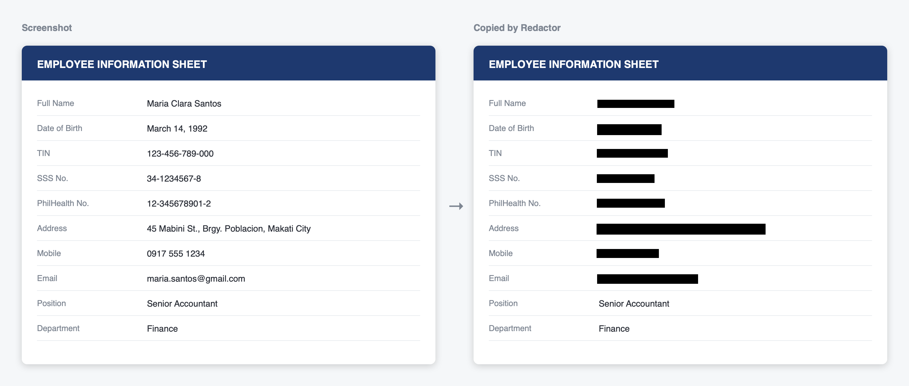
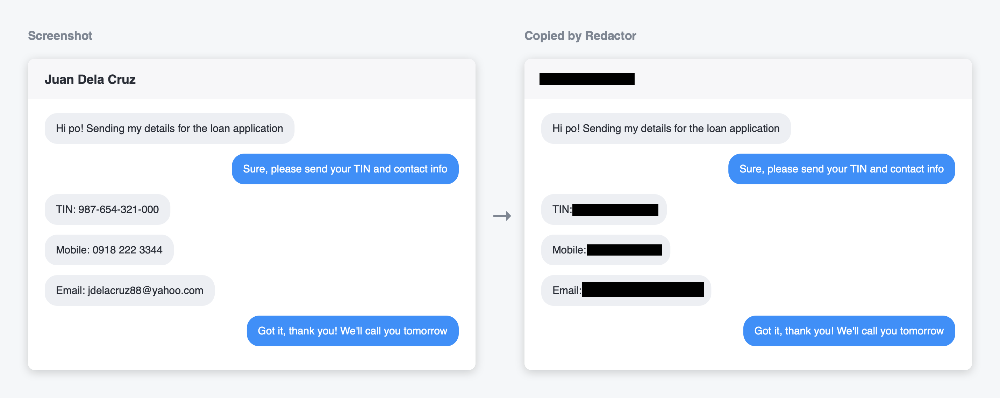
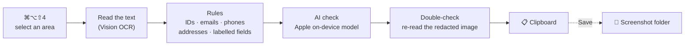

<div align="center">

# Redactor

**Screenshot anything. Personal info is blacked out before it ever reaches your clipboard.**

A macOS menu bar app for screenshots of IDs, payslips, forms and chats — built with Philippine documents in mind. Everything runs on your Mac.




</div>

## Why

A screenshot is the fastest way to share what's on your screen, and the easiest way to leak someone's TIN, birthday or phone number. Redactor replaces the macOS screenshot shortcut with one that finds that information and boxes it before you paste.

<p align="center">
  
</p>

## How it works



1. Press **⌘⌥⇧4** (or **Capture & Redact** in the menu bar) and select an area.
2. The preview opens right away. Boxes from the rules show up in about half a second; the AI check adds more a few seconds later. The menu bar icon turns into an hourglass while it works.
3. The redacted image is copied to your clipboard. Nothing is written to disk.
4. In the preview, **click** a box to turn it off or on, or **drag** to add one. **Save** writes the image to your screenshot folder and copies the edited version. **Close** keeps just the clipboard copy.

**Review Last Capture…** in the menu reopens any of the last five captures. They live in memory only and are gone when you quit.

## What gets redacted

| | Examples |
|---|---|
| **Philippine IDs** | TIN, SSS, PhilHealth, Pag-IBIG, PhilSys (PSN), UMID CRN, passport, LTO driver's licence |
| **Contact details** | Email addresses, phone numbers, street addresses, links |
| **Cards** | Credit and debit card numbers (Luhn-checked) |
| **Labelled form fields** | `Name:`, `Date of Birth`, `Apelyido / Last Name`, `Tirahan / Address`, … in English or Tagalog — the value next to or below the label |
| **AI check** | Names, birthdates, addresses and account numbers the rules missed |

Names and birthdates are redacted by the rules only when they have a label, so a document date or a company name isn't blacked out by mistake.

### The AI check

When Apple Intelligence is on, Apple's on-device language model reads the text as a second opinion. It can only **add** boxes, never remove one, and every value it reports must look like what it claims to be (a name has no digits, a birthdate is in the past, an ID has enough digits) and must actually appear on the page. The model doesn't support Filipino, so Filipino lines are covered by the rules only. If Apple Intelligence is off, the preview says so and the rules still run.

### The double-check

After the first pass, Redactor reads the **redacted** image again, up to twice, and boxes anything a detector can still read.

## Privacy

- 🔒 **The original is never saved.** The capture goes to a private temp file that is deleted as soon as it's read, and leftovers are cleaned up at launch.
- 🚫 **Fails closed.** If redaction fails, nothing is copied or saved.
- 🧾 **No metadata.** Saved PNGs keep only pixels, size, DPI and colour profile.
- 📋 **Clipboard guard.** Holding Control during selection makes macOS copy the unredacted image; Redactor notices and clears it.
- 📡 **No network.** OCR and the AI model both run on your Mac.

## Install

Requires macOS 26 and Xcode 26 (Swift 6.2). Apple Intelligence is optional, for the AI check.

```sh
git clone https://github.com/noelabu/redactor.git
cd redactor
make install
```

This builds the app, signs it, copies it to `~/Applications` and launches it. On first launch, allow **Screen Recording** in System Settings → Privacy & Security.

<details>
<summary><b>Why a signing certificate?</b></summary>

macOS ties the Screen Recording permission to the app's signature. `make install` creates a self-signed "Redactor Local Signing" certificate in your login keychain once, so the permission survives rebuilds. To stop codesign asking for keychain access on every build, run this once (it asks for your login password):

```sh
security set-key-partition-list -S apple-tool:,apple: -s -l "Redactor Local Signing" ~/Library/Keychains/login.keychain-db
```

</details>

<details>
<summary><b>All make targets</b></summary>

| Command | What it does |
|---|---|
| `make` | Run tests and build the app |
| `make test` | Run the test suite |
| `make app` | Build and sign `build/Redactor.app` |
| `make install` | Build, sign, install to `~/Applications` and launch |
| `make run` | Open the installed app |
| `make reset-tcc` | Reset the Screen Recording permission and reinstall |
| `make clean` | Remove build output |

</details>

## Development

```sh
swift test
```

Opt-in suites:

```sh
REDACTOR_AI_EVAL=1 swift test --filter AIEvalTests                         # real on-device model: recall and false hits
REDACTOR_TIMING_IMAGE=/path/to.png swift test --filter TimingTests         # time each stage on an image
REDACTOR_README_OUT=$PWD/docs/images swift test --filter ReadmeImageTests  # regenerate the images in this README
```

The README images are drawn from made-up data and redacted by the real engine.

```
Sources/RedactorCore/   detection, OCR, box geometry, rendering, PNG output
Sources/Redactor/       menu bar app: hotkey, capture, preview window
Tests/RedactorCoreTests/
scripts/                signing certificate setup
build.sh                builds, signs and installs the .app bundle
```
